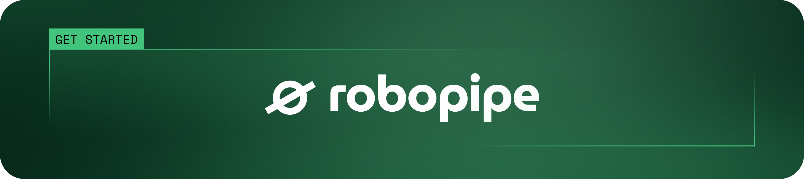

<p align="center">
  
</p>

# Robopipe Studio: AI visual quality inspection software for manufacturing

**Robopipe Studio is a web application for AI quality control on production lines. Quality and production teams use it to capture images, label defects, train deep-learning models and run them on Luxonis OAK edge cameras.**

Studio is the user interface of [Robopipe](https://robopipe.io/en), an industrial machine vision platform from Prague, Czech Republic. It covers the full computer vision pipeline for manufacturing in one tool: **capture, label, train and infer**. The trained model runs on the camera at the edge, so product images do not have to leave the plant.

Typical tasks are defect detection, foreign object detection, counting, and label and packaging checks. Studio is built for products with natural variation, such as food, where rule-based machine vision often fails.

> 🇨🇿 Robopipe Studio je software pro AI kamerovou kontrolu kvality ve výrobě. Více na [robopipe.io/cs](https://robopipe.io/cs).

|  Capture |  Label |
| :---: | :---: |
|  Train |  Infer |

## Features

- **Capture.** Find Robopipe controllers and Luxonis OAK cameras on the local network, watch the live stream and capture training images into a project.
- **Label.** Annotate images in the browser with bounding boxes, polygons and classification labels. Optional AI pre-annotation (`apps/ml-infer`, prototype) suggests polygons from an existing model.
- **Train.** Train object detection, instance segmentation and classification models with [luxonis-train](https://github.com/luxonis/luxonis-train) (`apps/ml`). Train YOLO object detection models with Ultralytics (`apps/ml-yolo`).
- **Export for the edge.** Export models to ONNX and convert them for Luxonis RVC2, RVC3 and RVC4 devices through Luxonis HubAI.
- **Infer.** Deploy a model to a camera through [Robopipe API](https://github.com/Robopipe/API) and see detections live. Sliced inference (SAHI) settings help with small defects.
- **Teams and projects.** Organisations, users, projects and label sets with JWT authentication.
- **REST API.** The Studio backend has OpenAPI (Swagger) documentation, so you can automate every step.

## How Studio fits into Robopipe

Robopipe has three public parts. Each part works on its own, and together they form a complete visual inspection system.

| Part | What it does | Where it runs |
| --- | --- | --- |
| **[Robopipe Studio](https://github.com/Robopipe/Studio)** (this repository) | Capture, labelling, training and deployment of AI models | Server or cloud, used in a web browser |
| **[Robopipe API](https://github.com/Robopipe/API)** | REST and WebSocket API for cameras, AI inference and PLC inputs and outputs | Robopipe controller or any Unix-based computer |
| **[Robopipe OS](https://github.com/Robopipe/OS)** | Operating system image with Robopipe API preinstalled | Robopipe controller (based on Unipi Patron) |
| **[Luxonis OAK cameras](https://www.luxonis.com/)** | Image capture and on-device neural network inference | Above the production line |

Studio talks to the cameras through Robopipe API. It sends the trained model to the camera, and the camera runs inference offline.

## Quick start

### Run with Docker

Prerequisites: Docker and Docker Compose.

1. Clone the repository:

   ```bash
   git clone https://github.com/Robopipe/Studio.git
   cd Studio
   ```

2. Create the environment files for the ML training services:

   ```bash
   cp apps/ml/.env.example apps/ml/.env
   cp apps/ml-yolo/.env.example apps/ml-yolo/.env
   ```

3. Start all services (PostgreSQL, API, web, ML training):

   ```bash
   docker compose up --build
   ```

4. In a separate terminal, run the database migrations:

   ```bash
   docker compose exec api pnpm -F api drizzle:push
   ```

5. Open the app:
   - Web app: [localhost:5173](http://localhost:5173)
   - API documentation (Swagger): [localhost:3000/doc](http://localhost:3000/doc)

The source code is volume-mounted, so changes reload automatically.

### Run from source

Prerequisites:

- Node.js 18 or higher and pnpm 10.28.0 or higher
- PostgreSQL 16 or higher with a database for Robopipe:
  ```bash
  psql -c "create database robopipe;"
  ```
- Git
- Python 3.11, only if you run the ML training services in `apps/ml` and `apps/ml-yolo`

1. Clone the repository:

   ```bash
   git clone https://github.com/Robopipe/Studio.git
   cd Studio
   ```

2. Install the dependencies:

   ```bash
   pnpm install
   ```

3. Create the environment files:

   ```bash
   cp apps/api/.env.example apps/api/.env
   cp apps/web/.env.example apps/web/.env.local
   ```

   Set `DATABASE_URL` in `apps/api/.env` for your PostgreSQL server.

4. Build the packages and run the database migrations:

   ```bash
   pnpm build && pnpm -F api drizzle:push
   ```

5. Start the app:

   ```bash
   pnpm dev
   ```

6. Open the app:
   - Web app: [localhost:5173](http://localhost:5173)
   - API documentation (Swagger): [localhost:3000/doc](http://localhost:3000/doc)

### Storage of images and models

The Studio backend stores images and models in Google Cloud Storage. Set the bucket name in `BUCKET_NAME` and give the backend Google Cloud credentials (Application Default Credentials).

### Repository structure

| Path | Content |
| --- | --- |
| `apps/web` | Web app (React, TypeScript, Vite) |
| `apps/api` | Backend REST API (NestJS, Drizzle ORM, PostgreSQL) |
| `apps/ml` | Training service for luxonis-train models (FastAPI, PyTorch, ONNX) |
| `apps/ml-yolo` | Training service for YOLO models (FastAPI, Ultralytics) |
| `apps/ml-infer` | Prototype for AI pre-annotation with ONNX Runtime |
| `packages/database` | Shared database schema |
| `packages/schema` | Shared validation schemas (Zod) |

## Robopipe as an alternative to Roboflow, Cognex and Keyence

Robopipe is an alternative to Roboflow, Cognex and Keyence for AI visual inspection on production lines. It is a complete inspection system: camera, controller with PLC inputs and outputs, trained model and line-side dashboards. The edge software ([Robopipe API](https://github.com/Robopipe/API)) is open source under the MIT licence.

- **Compared with Roboflow.** Roboflow is a developer platform for annotation, training and deployment, with a large library of public datasets. Robopipe focuses on the factory floor: hardware, PLC integration, operator dashboards and on-site support in Czechia and the EU. Choose Roboflow if you are a software team that builds its own vision product. Read [Roboflow alternatives in 2026](https://robopipe.io/en/blog/roboflow-alternatives-in-2026-an-honest-comparison-for-manufacturing-teams).
- **Compared with Cognex and Keyence.** Cognex and Keyence make excellent rule-based vision systems for gauging, barcode reading and pattern matching. Robopipe uses deep-learning models trained on your own good and defective parts, so it handles natural product variation. Robopipe is offered as a subscription instead of a capital purchase. Choose Cognex or Keyence for high-speed gauging at micron precision or 3D metrology. Read [Cognex alternatives in 2026](https://robopipe.io/en/blog/cognex-alternatives-in-2026-an-honest-comparison-for-production-lines) and [Keyence alternatives for machine vision](https://robopipe.io/en/blog/keyence-alternatives-for-machine-vision-an-honest-comparison-for-2026).

## Use cases

- **[Food processing](https://robopipe.io/en/industries#food):** defects, foreign objects and portion checks at line speed.
- **[Pharma and healthcare](https://robopipe.io/en/industries#pharma):** fill, closure and label verification, for example capsule counting in supplement jars.
- **[Retail and e-commerce](https://robopipe.io/en/industries#retail):** automated product tagging for the catalogue.
- **[Logistics](https://robopipe.io/en/industries#logistics):** live safety hazard detection and movement statistics.

See the [case studies](https://robopipe.io/en/case-studies) and the [Robopipe blog](https://robopipe.io/en/blog), for example [The capture-to-inference pipeline explained](https://robopipe.io/en/blog/capture-to-inference) and [What is a vision system?](https://robopipe.io/en/blog/what-is-a-vision-system-a-plain-english-guide-to-machine-vision-in-manufacturing)

## Documentation

Read the [Robopipe documentation](https://robopipe.gitbook.io/doc) for hardware setup, the API reference and examples.

## Feedback and community

Open a [GitHub issue](https://github.com/Robopipe/Studio/issues/new) for bugs, improvement ideas, documentation or developer experience. Join the [Robopipe subreddit](https://www.reddit.com/r/robopipe/) to share your apps and ask questions.

## License

Robopipe Studio is open source under the [MIT License](LICENSE).

## Contact

- Website: [robopipe.io](https://robopipe.io/en) ([česky](https://robopipe.io/cs))
- Book a demo or ask a question: [robopipe.io/en/contact](https://robopipe.io/en/contact)
- Pricing: [robopipe.io/en/pricing](https://robopipe.io/en/pricing)

Robopipe is developed by Robopipe s.r.o., Prague, Czech Republic.
